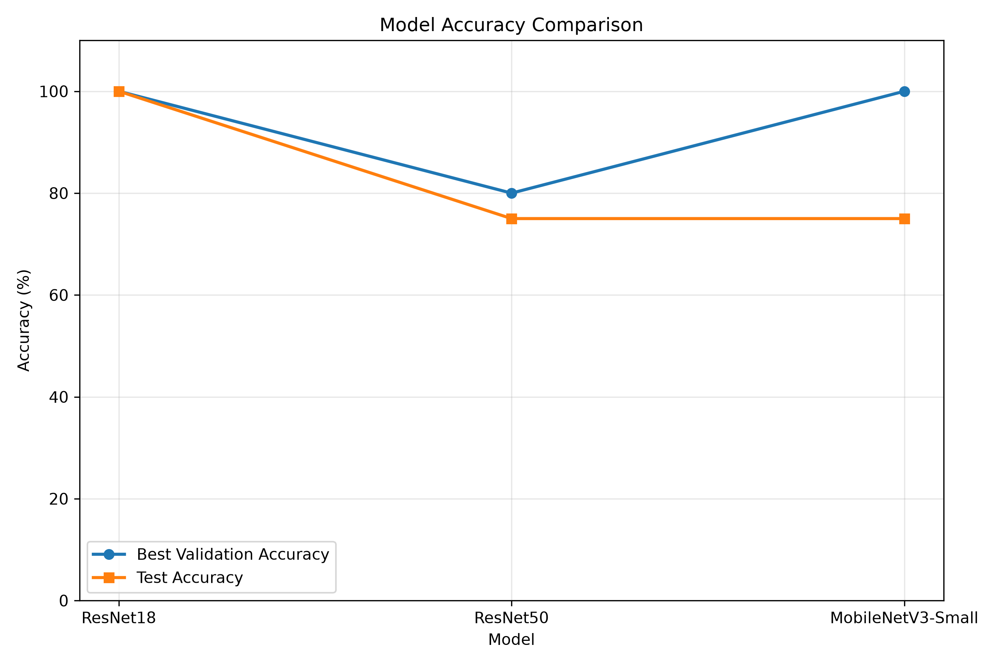
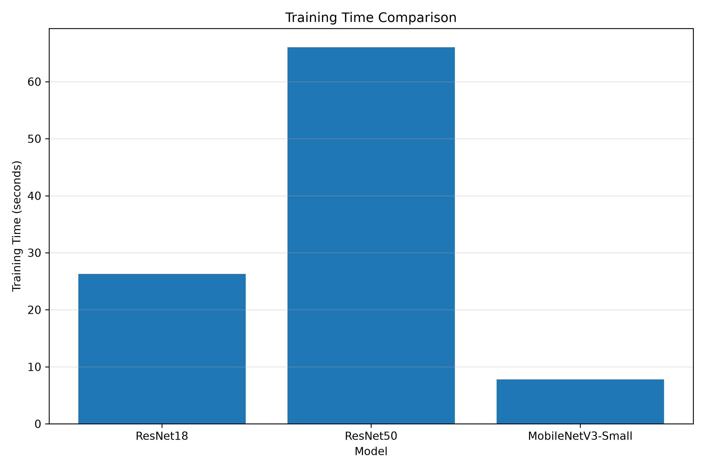
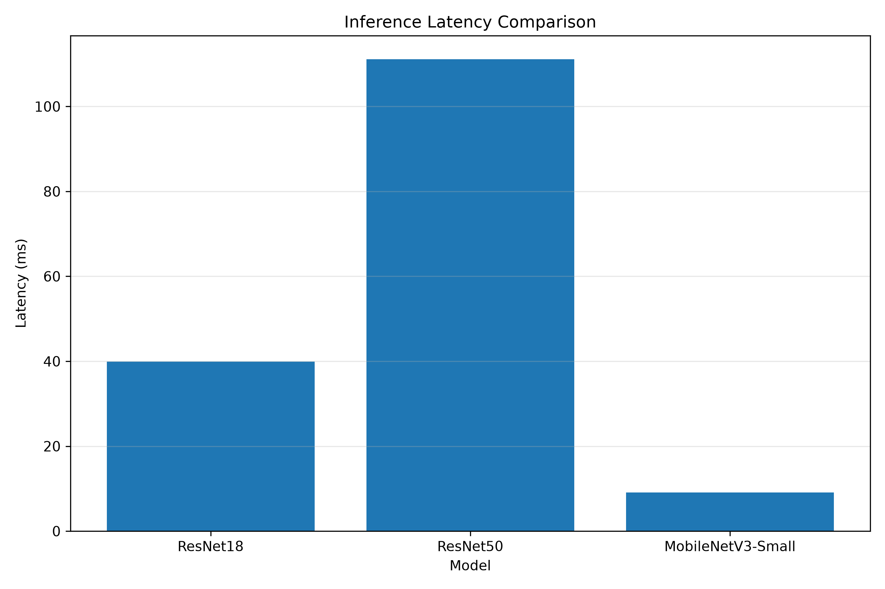
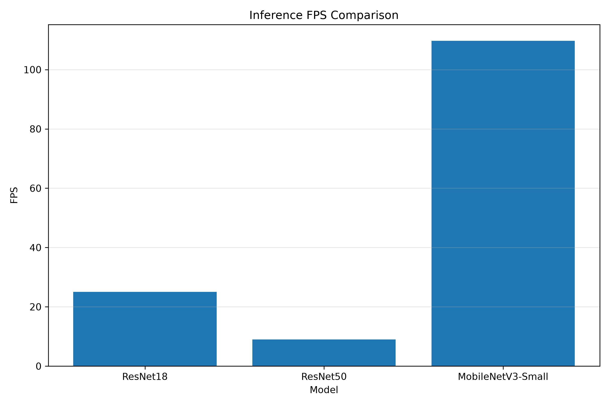

# Transfer Learning untuk Klasifikasi Titik Api

## Deskripsi

Proyek ini merupakan bagian dari PBL **Platform Rotorcraft Otonom Modular untuk Mendeteksi Titik Api**.

Eksperimen ini bertujuan untuk membandingkan beberapa model *deep learning* berbasis **transfer learning** untuk melakukan klasifikasi citra menjadi dua kelas:

* `fire` — citra yang mengandung api
* `no_fire` — citra yang tidak mengandung api

Model yang dibandingkan:

1. **ResNet18**
2. **ResNet50**
3. **MobileNetV3-Small**

Eksperimen menggunakan model pretrained ImageNet dan dilakukan menggunakan **PyTorch** serta **Torchvision**.

---

## Tujuan

Tujuan eksperimen adalah:

* Menerapkan transfer learning untuk klasifikasi citra.
* Membandingkan performa ResNet18, ResNet50, dan MobileNetV3-Small.
* Mengukur akurasi validasi dan pengujian.
* Mengukur waktu training.
* Mengukur latency inference.
* Mengukur FPS sebagai gambaran kemampuan inference.
* Menentukan karakteristik model yang sesuai untuk kebutuhan platform robot/drone dengan keterbatasan komputasi.

---

## Dataset

Dataset yang digunakan berjumlah **50 gambar**, terdiri dari dua kelas dengan jumlah yang seimbang.

| Kelas     | Jumlah |
| --------- | -----: |
| Fire      |     25 |
| No Fire   |     25 |
| **Total** | **50** |

Dataset disimpan pada:

```text
dataset_raw/
├── fire/
└── no_fire/
```

Metadata dataset tersedia pada:

```text
metadata.csv
```

Format metadata:

```csv
filename,class,source
fire_01.jpg,fire,dataset_raw
fire_02.jpg,fire,dataset_raw
...
no_fire_25.jpg,no_fire,dataset_raw
```

---

## Pembagian Dataset

Sebelum proses training, dataset dipisahkan menjadi tiga bagian:

| Dataset    |   Fire | No Fire |  Total |
| ---------- | -----: | ------: | -----: |
| Train      |     18 |      18 |     36 |
| Validation |      5 |       5 |     10 |
| Test       |      2 |       2 |      4 |
| **Total**  | **25** |  **25** | **50** |

Struktur dataset:

```text
dataset/
├── train/
│   ├── fire/
│   └── no_fire/
├── val/
│   ├── fire/
│   └── no_fire/
└── test/
    ├── fire/
    └── no_fire/
```

### Catatan Dataset

Jumlah data yang digunakan sengaja dibatasi menjadi 50 gambar sesuai kebutuhan eksperimen. Oleh karena itu, hasil pengujian perlu dipandang sebagai **hasil eksperimen awal**, bukan sebagai representasi performa model pada dataset besar.

Khusus test set, hanya terdapat 4 gambar. Dengan demikian, perubahan satu prediksi akan mengubah akurasi sebesar 25%.

---

## Metode Transfer Learning

Model menggunakan bobot pretrained dari **ImageNet**.

Pada eksperimen ini digunakan pendekatan **feature extraction**, yaitu backbone pretrained dibekukan dan bagian classifier diganti agar sesuai dengan dua kelas dataset.

### ResNet18

```text
Image
  ↓
ResNet18 pretrained
  ↓
Frozen backbone
  ↓
Fully Connected Layer
  ↓
2 Classes
  ↓
Fire / No Fire
```

### ResNet50

```text
Image
  ↓
ResNet50 pretrained
  ↓
Frozen backbone
  ↓
Fully Connected Layer
  ↓
2 Classes
  ↓
Fire / No Fire
```

### MobileNetV3-Small

```text
Image
  ↓
MobileNetV3-Small pretrained
  ↓
Frozen feature extractor
  ↓
Classifier
  ↓
2 Classes
  ↓
Fire / No Fire
```

---

## Konfigurasi Training

Konfigurasi utama:

| Parameter     | Nilai                  |
| ------------- | ---------------------- |
| Framework     | PyTorch                |
| Input Size    | 224 × 224              |
| Batch Size    | 8                      |
| Epoch         | 10                     |
| Optimizer     | Adam                   |
| Learning Rate | 0.001                  |
| Loss Function | Cross Entropy Loss     |
| Augmentation  | Random Horizontal Flip |
| Augmentation  | Random Rotation 10°    |
| Normalization | ImageNet               |
| Device        | CPU                    |
| Jumlah Kelas  | 2                      |

Karena CUDA tidak tersedia pada environment eksperimen, proses training dan inference dilakukan menggunakan CPU.

---

# Hasil Eksperimen

## Perbandingan Model

Hasil eksperimen:

| Model             | Best Val Accuracy | Test Accuracy | Training Time |   Latency |    FPS |
| ----------------- | ----------------: | ------------: | ------------: | --------: | -----: |
| ResNet18          |              100% |          100% |       26.30 s |  39.90 ms |  25.06 |
| ResNet50          |               80% |           75% |       66.03 s | 111.11 ms |   9.00 |
| MobileNetV3-Small |              100% |           75% |        7.81 s |   9.12 ms | 109.70 |

---

## ResNet18

Hasil training menunjukkan:

```text
Best Validation Accuracy : 100%
Training Time            : 26.30 seconds
Test Accuracy            : 100%
Latency                  : 39.90 ms/image
FPS                      : 25.06
```

Confusion matrix:

```text
              Predicted
             Fire  No Fire

Actual Fire    2      0
Actual NoFire  0      2
```

Pada test set, ResNet18 berhasil mengklasifikasikan seluruh 4 gambar dengan benar.

---

## ResNet50

Hasil training:

```text
Best Validation Accuracy : 80%
Training Time            : 66.03 seconds
Test Accuracy            : 75%
Latency                  : 111.11 ms/image
FPS                      : 9.00
```

Confusion matrix:

```text
              Predicted
             Fire  No Fire

Actual Fire    2      0
Actual NoFire  1      1
```

Terdapat satu citra `no_fire` yang diprediksi sebagai `fire`.

---

## MobileNetV3-Small

Hasil training:

```text
Best Validation Accuracy : 100%
Training Time            : 7.81 seconds
Test Accuracy            : 75%
Latency                  : 9.12 ms/image
FPS                      : 109.70
```

Confusion matrix:

```text
              Predicted
             Fire  No Fire

Actual Fire    2      0
Actual NoFire  1      1
```

Terdapat satu citra `no_fire` yang diprediksi sebagai `fire`.

---

# Grafik Hasil

Grafik hasil eksperimen tersedia pada folder:

```text
graphs/
```

### Perbandingan Accuracy



### Perbandingan Training Time



### Perbandingan Latency



### Perbandingan FPS



---

# Analisis

## 1. Akurasi

ResNet18 memperoleh **100% validation accuracy** dan **100% test accuracy** pada eksperimen ini.

MobileNetV3-Small juga memperoleh **100% validation accuracy**, tetapi test accuracy yang diperoleh adalah **75%**.

ResNet50 memperoleh **80% validation accuracy** dan **75% test accuracy**.

Perbedaan antara validation dan test menunjukkan bahwa performa model dapat berubah ketika model diberikan data yang belum digunakan dalam proses training.

Namun, jumlah test data yang hanya 4 gambar membuat interpretasi akurasi test menjadi sangat terbatas. Satu kesalahan prediksi langsung menyebabkan akurasi turun dari 100% menjadi 75%.

---

## 2. Training Time

Training time yang diperoleh:

```text
MobileNetV3-Small : 7.81 s
ResNet18          : 26.30 s
ResNet50          : 66.03 s
```

MobileNetV3-Small membutuhkan waktu training paling singkat pada eksperimen ini.

ResNet50 membutuhkan waktu training paling lama dibandingkan dua model lainnya.

---

## 3. Inference Latency

Hasil pengukuran latency:

```text
MobileNetV3-Small : 9.12 ms/image
ResNet18          : 39.90 ms/image
ResNet50          : 111.11 ms/image
```

MobileNetV3-Small memiliki latency inference paling rendah pada environment pengujian.

ResNet50 memiliki latency paling tinggi.

---

## 4. FPS

Hasil pengukuran:

```text
MobileNetV3-Small : 109.70 FPS
ResNet18          : 25.06 FPS
ResNet50          : 9.00 FPS
```

FPS menunjukkan jumlah citra yang dapat diproses per detik berdasarkan pengukuran inference pada environment eksperimen.

---

# Analisis untuk Platform Rotorcraft

Pada PBL **Platform Rotorcraft Otonom Modular untuk Mendeteksi Titik Api**, model klasifikasi akan menjadi salah satu bagian dari sistem persepsi.

Alur sederhananya:

```text
Kamera
   ↓
Image Acquisition
   ↓
Preprocessing
   ↓
Transfer Learning Model
   ↓
Fire / No Fire
   ↓
Decision System
   ↓
Sistem Rotorcraft
```

Karakteristik ketiga model memberikan trade-off yang berbeda antara performa klasifikasi dan kebutuhan komputasi.

**ResNet18** menghasilkan akurasi test 100% pada test set yang digunakan dan memiliki latency 39.90 ms/image.

**ResNet50** memiliki ukuran arsitektur yang lebih besar dan pada eksperimen ini menghasilkan latency 111.11 ms/image serta FPS 9.00.

**MobileNetV3-Small** menghasilkan latency 9.12 ms/image dan FPS 109.70, dengan waktu training 7.81 detik. Model ini menunjukkan karakteristik inference yang ringan pada environment pengujian.

Hasil tersebut digunakan sebagai data eksperimen dan bukan sebagai klaim bahwa model tertentu selalu lebih baik pada seluruh perangkat atau dataset.

---

# Keterbatasan Eksperimen

Eksperimen ini memiliki beberapa keterbatasan:

1. Dataset hanya terdiri dari 50 gambar.
2. Test set hanya terdiri dari 4 gambar.
3. Training dan inference dilakukan menggunakan CPU.
4. Hasil test accuracy sangat sensitif terhadap satu kesalahan prediksi karena ukuran test set kecil.
5. Dataset yang lebih besar diperlukan untuk evaluasi generalisasi yang lebih kuat.
6. Eksperimen ini menggunakan feature extraction dengan backbone pretrained yang dibekukan.
7. Belum dilakukan perbandingan dengan partial fine-tuning atau full fine-tuning.
8. Pengujian latency dilakukan pada environment komputer eksperimen dan dapat berbeda pada perangkat embedded atau komputer onboard rotorcraft.

---

# Struktur Folder

```text
transfer_learning_fire/
│
├── dataset_raw/
│   ├── fire/
│   └── no_fire/
│
├── dataset/
│   ├── train/
│   ├── val/
│   └── test/
│
├── models/
│   ├── mobilenet_best.pth
│   ├── resnet18_best.pth
│   └── resnet50_best.pth
│
├── results/
│   ├── mobilenet/
│   ├── resnet18/
│   ├── resnet50/
│   ├── test_summary.json
│   └── training_summary.json
│
├── graphs/
│   ├── accuracy_comparison.png
│   ├── fps_comparison.png
│   ├── latency_comparison.png
│   └── training_time_comparison.png
│
├── metadata.csv
├── create_metadata.py
├── split_dataset.py
├── train.py
├── evaluate.py
└── compare_results.py
```

---

# Cara Menjalankan

## 1. Membuat Metadata

```bash
python3 transfer_learning_fire/create_metadata.py
```

## 2. Split Dataset

```bash
python3 transfer_learning_fire/split_dataset.py
```

## 3. Training

```bash
python3 transfer_learning_fire/train.py
```

## 4. Evaluasi Test Set

```bash
python3 transfer_learning_fire/evaluate.py
```

## 5. Perbandingan Model

```bash
python3 transfer_learning_fire/compare_results.py
```

---

# Output

Model hasil training:

```text
models/
├── mobilenet_best.pth
├── resnet18_best.pth
└── resnet50_best.pth
```

Hasil evaluasi:

```text
results/
├── mobilenet/
├── resnet18/
├── resnet50/
├── test_summary.json
└── training_summary.json
```

Grafik:

```text
graphs/
├── accuracy_comparison.png
├── fps_comparison.png
├── latency_comparison.png
└── training_time_comparison.png
```

---

# Kesimpulan

Eksperimen berhasil menerapkan transfer learning untuk klasifikasi dua kelas, yaitu `fire` dan `no_fire`, menggunakan ResNet18, ResNet50, dan MobileNetV3-Small.

Pada dataset dan environment pengujian yang digunakan, ketiga model menunjukkan karakteristik yang berbeda dalam hal validation accuracy, test accuracy, training time, latency, dan FPS.

Hasil eksperimen menunjukkan bahwa pemilihan model untuk sistem rotorcraft tidak hanya mempertimbangkan akurasi, tetapi juga perlu mempertimbangkan kebutuhan komputasi dan kecepatan inference pada perangkat target.

Eksperimen berikutnya dapat dikembangkan dengan dataset yang lebih besar, pengujian pada perangkat onboard rotorcraft, serta perbandingan feature extraction dengan partial dan full fine-tuning.
